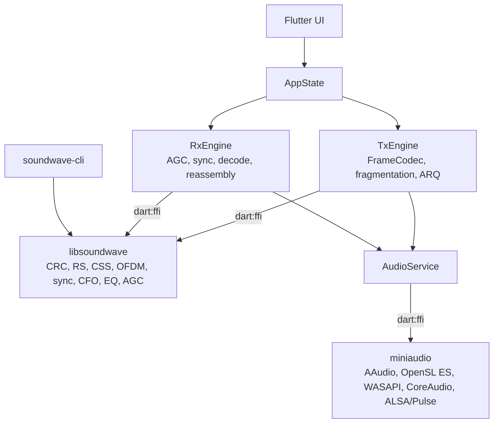

# Soundwave: Data over Sound

[](https://github.com/PxA-Labs/ultrasonic-phy-layer/actions/workflows/ci.yml)
[](https://github.com/PxA-Labs/ultrasonic-phy-layer/actions/workflows/build.yml)
[](https://github.com/PxA-Labs/ultrasonic-phy-layer/actions/workflows/docs.yml)
[](https://github.com/PxA-Labs/ultrasonic-phy-layer/actions/workflows/codeql.yml)
[](https://codecov.io/gh/PxA-Labs/ultrasonic-phy-layer)
[](LICENSE)

Soundwave is an experimental acoustic modem. It sends text and small files between nearby devices as high-frequency sound, using an ordinary speaker and microphone, with no network, Bluetooth or pairing.

- **`native/`**: a portable C11 DSP library (`libsoundwave`) with a stable C ABI. It contains CRC-32, Reed-Solomon RS(255,223), chirp (CSS) and OFDM modems, Zadoff-Chu / matched-filter sync, Schmidl-Cox CFO, LS channel estimation with ZF/MMSE equalization, AGC, and miniaudio audio I/O. The same directory holds the `soundwave-cli` tool.
- **`soundwave_app/`**: a Flutter app for Android, Windows, macOS and Linux. It adds a link layer (fragmentation, file transfer, optional stop-and-wait ARQ), live spectrum / waterfall / constellation views, WAV recording, import and export, onboarding, and theming and accessibility.

**Documentation site:** <https://pxa-labs.github.io/ultrasonic-phy-layer/>. It is built from [`docs/`](docs/) and deployed from `main`. It includes the [build guide](docs/getting-started/build.md), [user guide](docs/getting-started/user-guide.md), [architecture](docs/architecture/overview.md), [C API](docs/API_REFERENCE.md), [Dart API](docs/api/dart-api.md) and an in-browser [Signal Lab](docs/lab/index.md).

## Status

Pre-release (app version `1.0.0+1` in `pubspec.yaml`, no tagged release yet).

| Area | State |
|---|---|
| DSP core (CSS, OFDM, sync, CFO, equalization, RS, CRC, AGC) | Implemented. Unit, integration, AWGN and loopback tests, ASan/UBSan, libFuzzer and static analysis run in CI |
| Flutter app (TX/RX, link layer, file transfer, ARQ, visualizations, WAV tools, onboarding) | Implemented, with widget and unit tests plus real-DSP loopback tests in CI |
| Platforms | Android (NDK + AAudio/OpenSL ES), Windows (zip, MSIX), macOS (universal DMG), Linux (tar.gz, .deb, AppImage) build in CI. iOS is not set up |
| Release pipeline | `release.yml` builds, signs when secrets exist, and drafts a GitHub Release on `v*` tags |
| **Over-the-air performance** | **Not measured yet.** See the [field test plan](docs/testing/FIELD_TEST_PLAN.md) and the [hardware profiling plan](docs/testing/HARDWARE_PROFILING_PLAN.md) |
| Store publication | Draft [privacy policy](docs/legal/PRIVACY_POLICY.md), [terms](docs/legal/TERMS_OF_SERVICE.md) and [Play listing](docs/store/PLAY_STORE_LISTING.md), pending legal review |

## Signal parameters: what is measured, and what is not

There are **no field measurements yet**. Every number below is labeled with its source:

- **Derived**: computed exactly from the code's formulas at 44.1 kHz. Not measured.
- **Simulated**: from CI tests with software AWGN.
- **Target**: a [PRD](docs/PRD.md) goal that has not been verified.

| Quantity | CSS (default SF8, 2 kHz) | OFDM (default N=256, CP=64, QPSK) | Source |
|---|---|---|---|
| Occupied band | 18–20 kHz (centre 19 kHz ± 1 kHz) | ≈ 5.7–21.9 kHz (**audible**; the band is set by N, not by `carrier_freq`) | Derived |
| Raw PHY bit rate | 62.6 bit/s (8 bits per 127.7 ms chirp); 19.6–375.9 bit/s over SF 10..6 and 2–4 kHz | 22.9 kbit/s | Derived |
| Airtime, largest single frame (219 B payload) | 33.8 s (5.6 s at SF6, 4 kHz) | 0.11 s | Derived |
| BER under AWGN | < 10⁻³ at ≥ 3 dB SNR; ≤ 0.5 % at −7 dB for every SF | < 10⁻² at ≥ 10 dB SNR | Simulated (`native/tests/test_ber.c`, `test_css.c`) |
| Noiseless loopback EVM | n/a | < 1 % | Simulated (`native/tests/test_constellation.c`) |
| Error rate in the field | BER < 10⁻⁵ at 10 dB SNR | same | Target, untested |
| Range | ≥ 5 m at ≤ 80 dB SPL @ 1 m | same | Target, untested |
| Latency / startup / memory / CPU | < 50 ms / < 2 s / < 120 MB / < 15 % | same | Target, untested |

More configurations and the exact formulas are in [Signal chain & parameters](docs/architecture/signal-chain.md).

Earlier versions of this README contained a table of attenuation coefficients and operating ranges. Its source was not documented and it was never measured, so it has been removed. Air absorption at these frequencies is modelled by ISO 9613-1, and range will be reported only from field tests.

## Repository layout

```
.
├── native/                     C11 DSP core (CMake)
│   ├── include/soundwave_api.h   public C API
│   ├── include/soundwave/        module headers (types, css, ofdm, sync, rs, crc, agc, audio...)
│   ├── src/                      api/ css/ ofdm/ sync/ chanest/ equalizer/ rs/ crc/ fec/ packet/ agc/ audio/
│   ├── tests/                    CTest + Catch2 tests (unit, e2e, BER, memory safety)
│   ├── Fuzzing/                  libFuzzer harnesses + regression inputs
│   ├── benchmarks/               micro-benchmarks
│   ├── tools/soundwave_cli/      soundwave-cli (modulate / demodulate / simulate WAV files)
│   └── vendor/                   KissFFT, miniaudio (vendored)
├── soundwave_app/              Flutter app
│   ├── lib/native/               dart:ffi bindings
│   ├── lib/engine/               framing, TX/RX engines, link layer, ARQ, AGC wrapper
│   ├── lib/dsp/                  FFT, spectrum, waterfall, constellation (visualization)
│   ├── lib/export/               WAV record/import, offline decode, message export, storage
│   ├── lib/screens/, widgets/, onboarding/, theme/, services/, state/
│   ├── test/                     unit, widget, a11y and native loopback tests
│   └── android/ windows/ macos/ linux/  platform runners + packaging scripts
├── docs/                       documentation site sources (MkDocs)
├── mkdocs.yml                  site configuration
└── .github/workflows/          ci, build, release, docs, codeql, benchmark, changelog, labeler, lint-pr
```

## Build and test

Full instructions are in [docs/getting-started/build.md](docs/getting-started/build.md).

**Native core, tests and CLI** (Linux, macOS, Windows; CMake ≥ 3.20):

```bash
cd native
cmake -B build -DCMAKE_BUILD_TYPE=Release
cmake --build build --config Release --parallel
ctest --test-dir build --output-on-failure --build-config Release
./build/soundwave-cli modulate --mode css --input "Hello" --output hello.wav   # Windows: build\Release\soundwave-cli.exe
./build/soundwave-cli demodulate --mode css --input hello.wav
```

**Flutter app** (Flutter 3.47.x stable):

| Platform | Command | How `libsoundwave` is bundled |
|---|---|---|
| Linux | `flutter build linux --release` | CMake `ExternalProject` → `bundle/lib/libsoundwave.so` |
| Windows | `flutter build windows --release` | CMake `ExternalProject` → `soundwave.dll` next to the exe |
| macOS | `flutter build macos --release && macos/packaging/embed_native.sh` | universal dylib in `Contents/Frameworks` |
| Android | `flutter build apk --release --split-per-abi` / `flutter build appbundle` | Gradle `externalNativeBuild` (NDK) for arm64-v8a, armeabi-v7a, x86_64 |

**Flutter tests against the real DSP:**

```bash
cmake -S native -B native/build-ffi -DSW_BUILD_TESTS=OFF && cmake --build native/build-ffi --target soundwave_shared
cd soundwave_app && SOUNDWAVE_LIB=$PWD/../native/build-ffi/libsoundwave.so flutter test
```

**Docs site:** `pip install -r docs/requirements.txt && mkdocs serve`.

## Architecture



TX and RX sequence diagrams, frame formats and threading are covered in the [architecture overview](docs/architecture/overview.md). The equations are in the [mathematical model](docs/MATHEMATICAL_MODEL.md).

## Privacy

The app has no accounts, servers, analytics or crash reporting, and it does not use the network. Audio is processed on the device. **Transmissions are broadcast as sound and are not encrypted.** See the [draft privacy policy](docs/legal/PRIVACY_POLICY.md).

## Contributing, changelog, license

- [CONTRIBUTING.md](CONTRIBUTING.md) and the [developer guide](docs/DEVELOPER_GUIDE.md)
- [CHANGELOG.md](CHANGELOG.md) (generated by git-cliff)
- Developed under [PxA Labs](https://github.com/PxA-Labs) by Archit Mittal and Purvansh Joshi
- Licensed under the Apache License 2.0, see [LICENSE](LICENSE)
