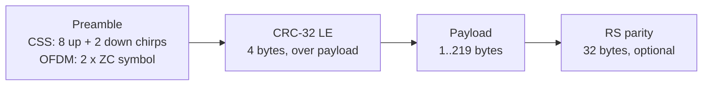

# Soundwave Developer & Architecture Guide

Welcome to the Soundwave Physical Layer (PHY) developer guide! This document provides an architectural sitemap, visual sequence diagrams, memory management contracts across the Dart FFI boundary, and setup instructions for contributors building or extending the native C library and Flutter application.

---

## 1. Architectural Sitemap & Repository Overview

```
ultrasonic-phy-layer/
├── docs/                        # Documentation site sources (MkDocs, see mkdocs.yml)
│   ├── getting-started/ architecture/ api/ lab/ testing/ legal/ store/ development/
│   ├── MATHEMATICAL_MODEL.md    # PHY equations
│   ├── API_REFERENCE.md         # C API reference (soundwave_api.h)
│   ├── DEVELOPER_GUIDE.md       # This file
│   └── CLI_GUIDE.md, CI_CD.md, PRD.md, ROADMAP.md, TECH_STACK.md
├── native/                      # C11 DSP core library (CMake)
│   ├── include/
│   │   ├── soundwave_api.h      # Public C ABI used by dart:ffi
│   │   └── soundwave/           # Module headers (types, css, ofdm, sync, cfo, chanest, rs, crc, agc, audio, ...)
│   ├── src/                     # api/ css/ ofdm/ sync/ chanest/ equalizer/ rs/ crc/ fec/ packet/ agc/ audio/
│   ├── vendor/                  # Vendored KissFFT and miniaudio
│   ├── tests/                   # CTest executables + Catch2 runner
│   ├── Fuzzing/                 # libFuzzer harnesses, regression inputs
│   ├── benchmarks/              # Micro-benchmarks (SW_BUILD_BENCHMARKS)
│   └── tools/soundwave_cli/     # soundwave-cli developer tool
├── soundwave_app/               # Flutter app (Android, Windows, macOS, Linux)
│   ├── lib/
│   │   ├── native/              # dart:ffi bindings (SoundwaveNative, SwConfig), hand-written
│   │   ├── engine/              # FrameCodec, TxEngine, RxEngine, link layer, ARQ, AGC wrapper
│   │   ├── dsp/                 # Visualization DSP (FFT, spectrum, waterfall, constellation)
│   │   ├── export/              # WAV recording/import, offline decoder, exporters, storage
│   │   ├── services/            # AudioService, microphone permission, received-file store
│   │   ├── state/               # AppState, settings persistence, UI preferences
│   │   ├── screens/ widgets/ onboarding/ theme/
│   │   └── main.dart
│   ├── test/                    # Unit, widget, a11y and native loopback tests
│   └── android/ windows/ macos/ linux/   # Runners and packaging scripts
└── .github/                     # Workflows, CODEOWNERS, PR template
```

---

## 2. PHY Frame Architecture & Data Flow

The app's PHY frame (`soundwave_app/lib/engine/frame_codec.dart`) is modulated by CSS or OFDM after a mode-specific preamble. CSS uses 8 up-chirps and 2 down-chirps; OFDM uses two identical Zadoff-Chu symbols.



There is no length field. The receiver tries candidate lengths until RS decoding and the CRC-32 both verify. `soundwave-cli` uses a different layout with a 16-bit length field, so the two are not interchangeable. The TX/RX sequence diagrams, threading and persistence are described in the [architecture overview](architecture/overview.md). Band, rate and airtime per configuration are in [Signal chain & parameters](architecture/signal-chain.md).

### Link Layer: Fragmentation, File Transfer & ARQ (#89, #100)

Implemented in pure Dart (`soundwave_app/lib/engine/`): `link_frame.dart`
(formats), `fragmentation.dart` (fragmenter/reassembler), `link_receiver.dart`
(RX policy), `arq.dart` (stop-and-wait sender). It runs inside the PHY frame
payload (`[CRC-32][payload <= 219 B][RS parity]`, see `frame_codec.dart`).

**Payload discrimination.** A PHY payload whose first byte is `0xFA` is a link
frame; anything else is legacy raw UTF-8 text (`0xFA` never occurs in UTF-8).
Short text with ARQ off is still sent as a legacy frame, so old receivers keep
working. Longer text, files, and everything sent with ARQ on use link frames.

| Frame | Layout (little-endian) | Size |
|-------|------------------------|------|
| DATA | `FA 01 flags src:u16 msgId:u16 index:u16 count:u16 chunk` | 11 + 1..208 B |
| ACK | `FA 02 00 src:u16 dst:u16 msgId:u16 index:u16` | 11 B |
| NACK | `FA 03 reason src:u16 dst:u16 msgId:u16 index:u16` | 11 B |

`flags` bit 0 = ACK requested. `src`/`dst` are random per-app 16-bit node ids;
frames with `src` equal to the local id are the device hearing its own speaker
and are ignored.

**Message envelope** (what gets fragmented): `kind:u8 (1 text, 2 file) |
length:u32 | crc32(content):u32 | [file: nameLen:u8 name mimeLen:u8 mime] |
content`. Content is limited to 1 MiB (about 5,050 fragments). The
reassembler delivers a message only when all `count` fragments are present
and the envelope CRC-32 verifies.

**Reassembly.** Fragments are buffered per `(src, msgId)` in any order.
Duplicates are dropped, and ids that were already delivered are remembered
for 10 minutes so retransmissions are not delivered twice. At most 8
concurrent messages are kept (the least recently updated one is evicted).
An incomplete message is abandoned after an idle timeout of
30 s + (maxRetries + 2) x (2 x max-frame airtime + largest backoff), and the
failure is reported on `RxEngine.transfers`.

**ARQ (stop-and-wait).** Only one side can transmit at a time, and frames are
long compared with the turnaround, so the sender waits for each fragment's ACK
before sending the next. The wait is
`airtime + responseAllowance + ackTimeout x 2^attempt (+ up to 10 % jitter)`.
`responseAllowance` is the ACK's airtime plus the RX decode latency, computed
from `FrameGeometry`. A NACK triggers an immediate retransmission. After
`maxRetries` retransmissions of one fragment the transfer fails with
`TxMaxRetriesError`. When a receiver sees a CRC/RS failure while exactly one
ARQ transfer is in progress, it NACKs that transfer's lowest missing fragment.
Otherwise it stays silent and the sender's timeout covers the loss. Identical
replies within 150 ms are debounced, and a genuine retransmission is always
ACKed again because it means the earlier ACK was lost.

**Settings** (`arq_enabled` default off, `arq_max_retries` 1/3/5,
`arq_ack_timeout_ms` 200-2000, added on top of the airtime). With ARQ off,
fragments are broadcast once, paced by their airtime, and receivers never
transmit. With ARQ on, **both** devices must enable it and listen. The app
starts listening automatically before an ARQ file send. Received files are
saved under `<app documents>/Soundwave/received/` with sanitized,
non-overwriting names (`services/received_file_store.dart`).

---

## 3. FFI Memory Ownership Contracts & Buffer Lifecycle

When calling C code from Dart via `dart:ffi`, managing memory safely across the language boundary is paramount to prevent memory leaks and dangling pointer crashes.

### Memory Rules

1. **Caller Allocates, Callee Fills**:
   - The Dart caller (`SoundwaveNative`) MUST allocate memory buffers using `ffi.calloc` or `ffi.malloc` before passing pointers to C functions.
   - Native C functions write into pre-allocated memory buffers and return written lengths via output parameter pointers (`size_t*`).

2. **Caller Frees**:
   - Any memory allocated by Dart MUST be freed by Dart using `calloc.free(ptr)` inside a `try ... finally` block after the native call completes.
   - Native C functions in `libsoundwave` DO NOT retain or free pointers passed to them.

3. **Buffer Length Estimation Formulas**:
   - **RS Parity Allocation**: $N_{\text{parity}} = 2t = N_{\text{block}} - K_{\text{data}}$ bytes (default 32 bytes for $RS(255, 223)$).
   - **CSS Audio Samples**: $N_{\text{samples}} = (10 + N_{\text{bits}}) \times \text{round}(T_{\text{symbol}} f_s)$ floats (10-chirp preamble, one chirp per bit).
   - **OFDM Audio Samples**: $N_{\text{samples}} = (2 + \lceil N_{\text{bits}} / B_{\text{sym}} \rceil) \times (N_{\text{fft}} + N_{\text{cp}})$, where $B_{\text{sym}}$ is data subcarriers times bits per subcarrier.
   - In practice, call once with a too-small capacity: the API returns `SW_ERR_OVERFLOW` and writes the required length.

### Memory Ownership Pattern Example (Dart FFI)

```dart
// Example: safe FFI allocation (pattern used in lib/native/soundwave_native.dart)
Pointer<Uint8> dataPtr = calloc<Uint8>(dataLen);
Pointer<Uint8> parityPtr = calloc<Uint8>(32);
Pointer<Size> parityLenPtr = calloc<Size>();

try {
  // Copy Dart list into native memory
  dataPtr.asTypedList(dataLen).setAll(0, dataBytes);
  
  // Call C API
  int result = _bindings.sw_rs_encode(dataPtr, dataLen, parityPtr, parityLenPtr);
  if (result != 0) throw Exception("RS Encode Failed: $result");
  
  // Read back native results
  int writtenLen = parityLenPtr.value;
  List<int> parityBytes = parityPtr.asTypedList(writtenLen).toList();
  return parityBytes;
} finally {
  // Free native memory guaranteed
  calloc.free(dataPtr);
  calloc.free(parityPtr);
  calloc.free(parityLenPtr);
}
```

---

## 4. Multi-Platform Setup & Build Guide

### Prerequisites

| Platform | Required Toolchain | Native Build System |
|---|---|---|
| **macOS** | Xcode Command Line Tools, Clang, CMake $\ge 3.20$, Flutter 3.47 | CMake + AppleClang |
| **Linux (Ubuntu/Debian)** | `build-essential`, `cmake`, `libasound2-dev`, Flutter 3.47 | CMake + GCC/Clang |
| **Windows** | Visual Studio 2022 (Desktop C++), CMake $\ge 3.20$, Flutter 3.47 | CMake + MSVC |
| **Android** | Android Studio, Android NDK (r26+), CMake $\ge 3.20$, Flutter 3.47 | CMake + NDK Clang |

---

### Step 1: Building the Native C/C++ Core Library

```bash
# 1. Clone repository (dependencies are vendored; no submodules)
git clone https://github.com/PxA-Labs/ultrasonic-phy-layer.git
cd ultrasonic-phy-layer

# 2. Create build directory
mkdir -p build && cd build

# 3. Configure CMake (Release mode)
cmake ../native -DCMAKE_BUILD_TYPE=Release

# 4. Build native shared & static libraries + test executables
cmake --build . --parallel

# 5. Run test suite via CTest
ctest --output-on-failure
```

### CMake Presets (Optional)

We provide standard `CMakePresets.json` configurations in `native/`:

```bash
cd native
cmake --preset release
cmake --build --preset release
ctest --preset release
```

Available presets: `default`, `debug`, `release`, `asan`, `ubsan`, `fuzz` (see [Sanitizers & Fuzzing](#sanitizers--fuzzing)).

---

### Step 2: Running the Flutter App

```bash
# 1. Navigate to Flutter app directory
cd soundwave_app

# 2. Fetch Dart dependencies
flutter pub get

# 3. Bindings in lib/native/ are hand-written: update soundwave_native.dart
#    and bindings.dart by hand if soundwave_api.h changes.

# 4. Run app on local desktop target
flutter run -d macos    # macOS
flutter run -d linux    # Linux
flutter run -d windows  # Windows
```

---

### Native library for Flutter tests

`SoundwaveNative` loads `libsoundwave` from `native/build/` (then the legacy `build/`). Set `SOUNDWAVE_LIB=/abs/path/to/libsoundwave.{so,dylib,dll}` to pin a specific build, for example a sanitizer build or the one CI produces. `test/native/loopback_test.dart` runs real TX → audio → RX round trips (CSS and OFDM) against it. Locally it is skipped when no library loads, while CI sets `SOUNDWAVE_REQUIRE_NATIVE=1` so a missing library fails the job.

```bash
cmake -S native -B native/build -DSW_BUILD_TESTS=OFF && cmake --build native/build --target soundwave_shared
cd soundwave_app && flutter test
```

---

### Android (NDK + AAudio)

No separate native build step is needed: `soundwave_app/android/app/build.gradle.kts` points Gradle's `externalNativeBuild` at `native/CMakeLists.txt`, so `flutter build apk` / `flutter run` compiles `libsoundwave.so` with the NDK (`ndkVersion` comes from the Flutter SDK) for `arm64-v8a`, `armeabi-v7a` and `x86_64` and packages it under `lib/<abi>/`. Dart loads it with `DynamicLibrary.open('libsoundwave.so')`.

Requirements: Android SDK with NDK and CMake 3.22+ (Gradle installs them on demand once the SDK licenses are accepted), JDK 17.

```bash
cd soundwave_app
flutter build apk --debug                      # all ABIs, debug-signed
flutter build apk --release --split-per-abi    # app-<abi>-release.apk
flutter build appbundle --release              # app-release.aab (Play Store)
unzip -l build/app/outputs/flutter-apk/app-arm64-v8a-release.apk | grep libsoundwave.so
```

Android specifics in the native build:

- **Audio backend:** `audio_io.c` compiles only miniaudio's AAudio and OpenSL ES backends. AAudio is used on API 26+, OpenSL ES is the fallback. Both use the low-latency performance profile and the *unprocessed* input preset, because the default voice presets apply AGC, noise suppression and low-pass filtering that remove the 18–22 kHz band.
- **SIMD:** NEON is required (`SW_REQUIRE_NEON`, a compile error otherwise) on `arm64-v8a` and `armeabi-v7a`. `x86_64` uses SSE4.2 and never AVX2, which the Android x86_64 ABI does not guarantee.
- **Linking:** `m dl log`, a 16 KB page-aligned ELF (needed for Play Store uploads targeting Android 15+), and no versioned SONAME.
- **Permissions:** the manifest declares `RECORD_AUDIO` and `MODIFY_AUDIO_SETTINGS`. On first launch, `MicPermissionGate` explains why the microphone is needed and then shows the system prompt. `NativeAudioService.startCapture()` checks the permission again and throws `MicrophonePermissionDenied` if it is missing.

**Release signing:** create `soundwave_app/android/key.properties` (it is gitignored) with `storeFile`, `storePassword`, `keyAlias` and `keyPassword`. `storeFile` is relative to `android/app/`. Without that file, release builds are debug-signed. In CI, the `build-android` job in `build.yml` writes the file from the `ANDROID_KEYSTORE_BASE64` (base64 of the `.jks`), `ANDROID_KEYSTORE_PASSWORD`, `ANDROID_KEY_ALIAS` and `ANDROID_KEY_PASSWORD` secrets when they are set. The job uploads `android-debug-apk`, `android-release-apks` and `android-release-aab`. It fails if `libsoundwave.so` is missing for any ABI, if the expected `sw_*` symbols are not exported, or if the 64-bit `.so` is not 16 KB aligned. To run it on a branch, use `gh workflow run build.yml --ref <branch>`.

---

## 5. Testing & Debugging Framework

### Running Native C Unit Tests

```bash
cd native/build            # test executables are in tests/ (MSVC: tests/Release/)
ctest -R test_ofdm --output-on-failure   # run a subset by name
./tests/test_crc           # Test CRC-32 checksums
./tests/test_rs_encoder    # Test GF(2^8) & Reed-Solomon encoder
./tests/test_rs_decoder    # Test BMA, Chien search & Forney decoder
./tests/test_modulator     # Test CSS & OFDM modulation
./tests/test_sync          # Test Zadoff-Chu & preamble timing sync
./tests/catch_tests        # Run Catch2 C++ test runner
```

### Sanitizers & Fuzzing

The DSP core treats every `sw_*` call as a trust boundary: Dart passes user-controlled settings and microphone samples straight into C. Sanitizer and fuzzing support is built in (issue #28).

| CMake option | Default | Effect |
|---|---|---|
| `SW_ENABLE_ASAN` | OFF | AddressSanitizer (+LeakSanitizer on Linux). GCC/Clang: `-fsanitize=address`; MSVC: `/fsanitize=address` |
| `SW_ENABLE_UBSAN` | OFF | UndefinedBehaviorSanitizer, fatal on the first report. With Clang it also traps float division by zero, which in DSP code signals a missing guard |
| `SW_ENABLE_FUZZER` | OFF | Builds the `native/Fuzzing/` harnesses as real libFuzzer binaries (needs LLVM Clang; AppleClang has no libFuzzer) |
| `SW_FUZZ_SMOKE` | ON | Builds the same harnesses with a standalone driver and registers them in CTest as `fuzz_*_smoke` (`SW_FUZZ_SMOKE_RUNS` random inputs each) |
| `SW_USE_SANITIZER`, `SW_BUILD_FUZZ` | OFF | Deprecated aliases for ASan+UBSan and `SW_ENABLE_FUZZER` |

```bash
cd native
cmake --preset asan  && cmake --build build/asan  && ctest --test-dir build/asan  --output-on-failure
cmake --preset ubsan && cmake --build build/ubsan && ctest --test-dir build/ubsan --output-on-failure

# libFuzzer (Linux, or macOS with Homebrew LLVM)
cmake --preset fuzz && cmake --build build/fuzz
./build/fuzz/Fuzzing/fuzz_api -max_total_time=60
```

**Harnesses** (`native/Fuzzing/`). Each one checks *properties*, not just "no crash":

- `fuzz_crc`: the table, fast and FFI CRC paths agree, and every 1-bit error is detected.
- `fuzz_rs`: arbitrary words decode only to valid codewords, and encode→corrupt(≤16)→decode restores the message with the exact error count.
- `fuzz_packet`, `fuzz_fec`: decoding arbitrary bytes is safe, and encode→decode round-trips.
- `fuzz_css`, `fuzz_ofdm`: raw samples (NaN/Inf/huge) through the internal entry points and the FFI wrappers.
- `fuzz_api`: every `sw_*` function with fuzzed configs and exact-capacity output buffers. It includes modulate→perturb→demodulate round trips so deep demodulator paths get exercised.

**Reproducing a CI crash.** Download the `crash-<target>` artifact and replay it. The same command works with the libFuzzer and the smoke builds:

```bash
./build/asan/Fuzzing/fuzz_api path/to/crash-<sha1>
```

**macOS note.** On some macOS releases the AppleClang ASan runtime hangs during start-up. Homebrew LLVM works: configure with `-DCMAKE_C_COMPILER=$(brew --prefix llvm)/bin/clang -DCMAKE_CXX_COMPILER=$(brew --prefix llvm)/bin/clang++`, which also gives you libFuzzer on macOS. When ASan is off, the CTest fuzz smoke tests on macOS automatically run under Guard Malloc (`libgmalloc`), which puts every allocation against a guard page so heap overruns still fault.

**Canaries.** In ASan builds, `asan_trigger_*` tests make deliberate overflow, use-after-free and (Linux) leak errors. They pass only when the sanitizer report appears, so a green run proves the sanitizer is actually active.

**Static analysis.** CI runs `cppcheck` (`native/.cppcheck-suppressions`) and `clang-tidy` (`native/.clang-tidy`). Clang Static Analyzer findings fail the build; bugprone/CERT checks are advisory.

---

## 6. Code Style & Commit Guidelines

- **C11 Code Standard**: Use explicit fixed-width integers (`uint8_t`, `int32_t`, `size_t`).
- **Doxygen Documentation**: All public functions in `soundwave_api.h` MUST have Doxygen docstrings (`/** ... */`).
- **Conventional Commits**: Format commit messages as `type(scope): summary` (e.g. `feat(dsp-core): implement Reed-Solomon decoder (#18)`).
