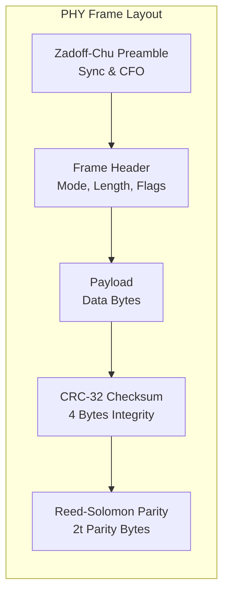
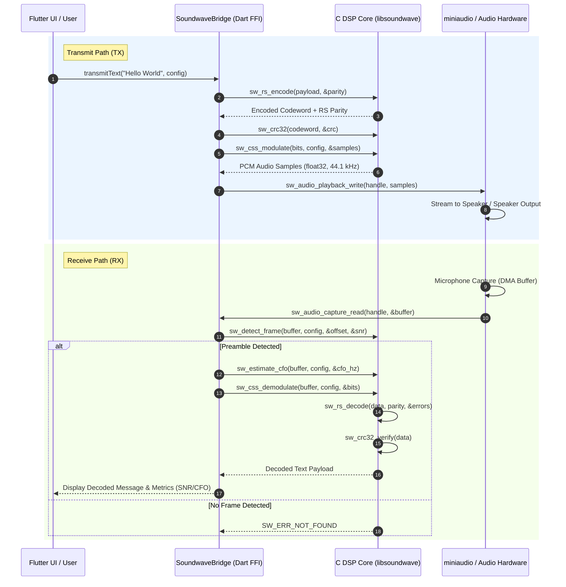

# Soundwave Developer & Architecture Guide

Welcome to the Soundwave Physical Layer (PHY) developer guide! This document provides an architectural sitemap, visual sequence diagrams, memory management contracts across the Dart FFI boundary, and setup instructions for contributors building or extending the native C library and Flutter application.

---

## 1. Architectural Sitemap & Repository Overview

```
ultrasonic-phy-layer/
├── docs/                        # Specifications & Mathematical Models
│   ├── MATHEMATICAL_MODEL.md    # PHY equations (GF(2^8), Chirp, OFDM, ZC)
│   ├── PRD.md                   # Product Requirements Document
│   ├── ROADMAP.md               # Implementation Roadmap & Milestones
│   ├── TECH_STACK.md            # Technology stack details
│   ├── DEVELOPER_GUIDE.md       # Architecture & Developer Guide (This file)
│   └── API_REFERENCE.md         # Comprehensive C/C++ & FFI API Reference
├── native/                      # C/C++ PHY Core DSP Library
│   ├── include/                 # Public C headers
│   │   ├── soundwave_api.h      # Public C FFI boundary API
│   │   └── soundwave/           # Module headers (rs, crc, css, ofdm, sync, audio)
│   ├── src/                     # C DSP source code
│   │   ├── rs/                  # GF(2^8) & Reed-Solomon Codec
│   │   ├── crc/                 # CRC-32 IEEE 802.3 Checksum
│   │   ├── css/                 # Chirp Spread Spectrum Modulator/Demodulator
│   │   ├── ofdm/                # OFDM Modulator/Demodulator & FFT
│   │   ├── sync/                # Timing Sync & Schmidl-Cox CFO Estimation
│   │   ├── audio/               # miniaudio I/O & Thread-Safe Ring Buffer
│   │   └── api/                 # C API implementation & FFI helpers
│   ├── vendor/                  # Vendored dependencies (KissFFT v131, miniaudio)
│   ├── tests/                   # CTest & Catch2 Unit / Integration Tests
│   └── benchmarks/              # Microbenchmarks & Performance Harness
├── soundwave_app/               # Flutter UI & Cross-Platform Host Application
│   ├── lib/                     # Dart source code
│   │   ├── bridge/              # dart:ffi C bindings wrapper (SoundwaveBridge)
│   │   ├── features/            # UI screens (TX, RX, Settings, Spectrum)
│   │   └── services/            # Audio Service & Frame Pipeline
│   └── test/                    # Flutter widget and unit tests
└── .github/                     # Workflows, Codeowners & PR Templates
```

---

## 2. PHY Frame Architecture & Data Flow

Soundwave transmits data over ultrasound (18 kHz – 20 kHz) by encapsulating payloads into structured PHY frames.

### Ultrasonic PHY Frame Structure



### End-to-End Transmit & Receive Sequence Flow

The diagram below illustrates the multi-tier interaction between the Flutter UI, Dart FFI Bridge, Native C DSP Core, and OS Audio Hardware (`miniaudio`):



---

## 3. FFI Memory Ownership Contracts & Buffer Lifecycle

When calling C code from Dart via `dart:ffi`, managing memory safely across the language boundary is paramount to prevent memory leaks and dangling pointer crashes.

### Memory Rules

1. **Caller Allocates, Callee Fills**:
   - The Dart caller (`SoundwaveBridge`) MUST allocate memory buffers using `ffi.calloc` or `ffi.malloc` before passing pointers to C functions.
   - Native C functions write into pre-allocated memory buffers and return written lengths via output parameter pointers (`size_t*`).

2. **Caller Frees**:
   - Any memory allocated by Dart MUST be freed by Dart using `calloc.free(ptr)` inside a `try ... finally` block after the native call completes.
   - Native C functions in `libsoundwave` DO NOT retain or free pointers passed to them.

3. **Buffer Length Estimation Formulas**:
   - **RS Parity Allocation**: $N_{\text{parity}} = 2t = N_{\text{block}} - K_{\text{data}}$ bytes (default 32 bytes for $RS(255, 223)$).
   - **CSS Audio Samples**: $N_{\text{samples}} = N_{\text{bits}} \times T_{\text{symbol}} \times f_s$ floats (where $f_s = 44100\text{ Hz}$).
   - **OFDM Audio Samples**: $N_{\text{samples}} = \lceil N_{\text{bits}} / (\text{subcarriers} \times \text{bits\_per\_symbol}) \rceil \times (N_{\text{fft}} + N_{\text{cp}})$.

### Memory Ownership Pattern Example (Dart FFI)

```dart
// Example: Safe FFI Allocation in SoundwaveBridge
Pointer<Uint8> dataPtr = calloc<Uint8>(dataLen);
Pointer<Uint8> parityPtr = calloc<Uint8>(32);
Pointer<Size> parityLenPtr = calloc<Size>();

try {
  // Copy Dart list into native memory
  dataPtr.asTypedList(dataLen).setAll(0, dataBytes);
  
  // Call C API
  int result = _bindings.sw_rs_encode(dataPtr, dataLen, parityPtr, parityLenPtr);
  if (result != 0) throw Exception("RS Encode Failed: $result");
  
  // Read back native results
  int writtenLen = parityLenPtr.value;
  List<int> parityBytes = parityPtr.asTypedList(writtenLen).toList();
  return parityBytes;
} finally {
  // Free native memory guaranteed
  calloc.free(dataPtr);
  calloc.free(parityPtr);
  calloc.free(parityLenPtr);
}
```

---

## 4. Multi-Platform Setup & Build Guide

### Prerequisites

| Platform | Required Toolchain | Native Build System |
|---|---|---|
| **macOS** | Xcode Command Line Tools, Clang, CMake $\ge 3.20$, Flutter 3.47 | CMake + AppleClang |
| **Linux (Ubuntu/Debian)** | `build-essential`, `cmake`, `libasound2-dev`, Flutter 3.47 | CMake + GCC/Clang |
| **Windows** | Visual Studio 2022 (Desktop C++), CMake $\ge 3.20$, Flutter 3.47 | CMake + MSVC |
| **Android** | Android Studio, Android NDK (r26+), CMake $\ge 3.20$, Flutter 3.47 | CMake + NDK Clang |

---

### Step 1: Building the Native C/C++ Core Library

```bash
# 1. Clone repository with submodules
git clone https://github.com/PxA-Labs/ultrasonic-phy-layer.git
cd ultrasonic-phy-layer

# 2. Create build directory
mkdir -p build && cd build

# 3. Configure CMake (Release mode)
cmake ../native -DCMAKE_BUILD_TYPE=Release

# 4. Build native shared & static libraries + test executables
cmake --build . --parallel

# 5. Run test suite via CTest
ctest --output-on-failure
```

### CMake Presets (Optional)

We provide standard `CMakePresets.json` configurations in `native/`:

```bash
cd native
cmake --preset release
cmake --build --preset release
ctest --preset release
```

Available presets: `default`, `debug`, `release`, `asan`, `ubsan`, `fuzz` (see [Sanitizers & Fuzzing](#sanitizers--fuzzing)).

---

### Step 2: Running the Flutter App

```bash
# 1. Navigate to Flutter app directory
cd soundwave_app

# 2. Fetch Dart dependencies
flutter pub get

# 3. Regenerate FFI bindings (if soundwave_api.h changed)
dart run ffigen

# 4. Run app on local desktop target
flutter run -d macos    # macOS
flutter run -d linux    # Linux
flutter run -d windows  # Windows
```

---

### Native library for Flutter tests

`SoundwaveNative` loads `libsoundwave` from `native/build/` (then the legacy `build/`). Set `SOUNDWAVE_LIB=/abs/path/to/libsoundwave.{so,dylib,dll}` to pin a specific build, for example a sanitizer build or the one CI produces. `test/native/loopback_test.dart` runs real TX → audio → RX round trips (CSS and OFDM) against it. Locally it is skipped when no library loads, while CI sets `SOUNDWAVE_REQUIRE_NATIVE=1` so a missing library fails the job.

```bash
cmake -S native -B native/build -DSW_BUILD_TESTS=OFF && cmake --build native/build --target soundwave_shared
cd soundwave_app && flutter test
```

---

### Android (NDK + AAudio)

No separate native build step is needed: `soundwave_app/android/app/build.gradle.kts` points Gradle's `externalNativeBuild` at `native/CMakeLists.txt`, so `flutter build apk` / `flutter run` compiles `libsoundwave.so` with the NDK (`ndkVersion` comes from the Flutter SDK) for `arm64-v8a`, `armeabi-v7a` and `x86_64` and packages it under `lib/<abi>/`. Dart loads it with `DynamicLibrary.open('libsoundwave.so')`.

Requirements: Android SDK with NDK and CMake 3.22+ (Gradle installs them on demand once the SDK licenses are accepted), JDK 17.

```bash
cd soundwave_app
flutter build apk --debug                      # all ABIs, debug-signed
flutter build apk --release --split-per-abi    # app-<abi>-release.apk
flutter build appbundle --release              # app-release.aab (Play Store)
unzip -l build/app/outputs/flutter-apk/app-arm64-v8a-release.apk | grep libsoundwave.so
```

Android specifics in the native build:

- **Audio backend:** `audio_io.c` compiles only miniaudio's AAudio and OpenSL ES backends. AAudio is used on API 26+, OpenSL ES is the fallback. Both use the low-latency performance profile and the *unprocessed* input preset, because the default voice presets apply AGC, noise suppression and low-pass filtering that remove the 18–22 kHz band.
- **SIMD:** NEON is required (`SW_REQUIRE_NEON`, a compile error otherwise) on `arm64-v8a` and `armeabi-v7a`. `x86_64` uses SSE4.2 and never AVX2, which the Android x86_64 ABI does not guarantee.
- **Linking:** `m dl log`, a 16 KB page-aligned ELF (needed for Play Store uploads targeting Android 15+), and no versioned SONAME.
- **Permissions:** the manifest declares `RECORD_AUDIO` and `MODIFY_AUDIO_SETTINGS`. On first launch, `MicPermissionGate` explains why the microphone is needed and then shows the system prompt. `NativeAudioService.startCapture()` checks the permission again and throws `MicrophonePermissionDenied` if it is missing.

**Release signing:** create `soundwave_app/android/key.properties` (it is gitignored) with `storeFile`, `storePassword`, `keyAlias` and `keyPassword`. `storeFile` is relative to `android/app/`. Without that file, release builds are debug-signed. In CI, the `build-android` job in `build.yml` writes the file from the `ANDROID_KEYSTORE_BASE64` (base64 of the `.jks`), `ANDROID_KEYSTORE_PASSWORD`, `ANDROID_KEY_ALIAS` and `ANDROID_KEY_PASSWORD` secrets when they are set. The job uploads `android-debug-apk`, `android-release-apks` and `android-release-aab`. It fails if `libsoundwave.so` is missing for any ABI, if the expected `sw_*` symbols are not exported, or if the 64-bit `.so` is not 16 KB aligned. To run it on a branch, use `gh workflow run build.yml --ref <branch>`.

---

## 5. Testing & Debugging Framework

### Running Native C Unit Tests

```bash
cd build
./tests/test_crc           # Test CRC-32 checksums
./tests/test_rs_encoder    # Test GF(2^8) & Reed-Solomon encoder
./tests/test_rs_decoder    # Test BMA, Chien search & Forney decoder
./tests/test_modulator     # Test CSS & OFDM modulation
./tests/test_sync          # Test Zadoff-Chu & preamble timing sync
./tests/catch_tests        # Run Catch2 C++ test runner
```

### Sanitizers & Fuzzing

The DSP core treats every `sw_*` call as a trust boundary: Dart passes user-controlled settings and microphone samples straight into C. Sanitizer and fuzzing support is built in (issue #28).

| CMake option | Default | Effect |
|---|---|---|
| `SW_ENABLE_ASAN` | OFF | AddressSanitizer (+LeakSanitizer on Linux). GCC/Clang: `-fsanitize=address`; MSVC: `/fsanitize=address` |
| `SW_ENABLE_UBSAN` | OFF | UndefinedBehaviorSanitizer, fatal on the first report. With Clang it also traps float division by zero, which in DSP code signals a missing guard |
| `SW_ENABLE_FUZZER` | OFF | Builds the `native/Fuzzing/` harnesses as real libFuzzer binaries (needs LLVM Clang; AppleClang has no libFuzzer) |
| `SW_FUZZ_SMOKE` | ON | Builds the same harnesses with a standalone driver and registers them in CTest as `fuzz_*_smoke` (`SW_FUZZ_SMOKE_RUNS` random inputs each) |
| `SW_USE_SANITIZER`, `SW_BUILD_FUZZ` | OFF | Deprecated aliases for ASan+UBSan and `SW_ENABLE_FUZZER` |

```bash
cd native
cmake --preset asan  && cmake --build build/asan  && ctest --test-dir build/asan  --output-on-failure
cmake --preset ubsan && cmake --build build/ubsan && ctest --test-dir build/ubsan --output-on-failure

# libFuzzer (Linux, or macOS with Homebrew LLVM)
cmake --preset fuzz && cmake --build build/fuzz
./build/fuzz/Fuzzing/fuzz_api -max_total_time=60
```

**Harnesses** (`native/Fuzzing/`). Each one checks *properties*, not just "no crash":

- `fuzz_crc`: the table, fast and FFI CRC paths agree, and every 1-bit error is detected.
- `fuzz_rs`: arbitrary words decode only to valid codewords, and encode→corrupt(≤16)→decode restores the message with the exact error count.
- `fuzz_packet`, `fuzz_fec`: decoding arbitrary bytes is safe, and encode→decode round-trips.
- `fuzz_css`, `fuzz_ofdm`: raw samples (NaN/Inf/huge) through the internal entry points and the FFI wrappers.
- `fuzz_api`: every `sw_*` function with fuzzed configs and exact-capacity output buffers. It includes modulate→perturb→demodulate round trips so deep demodulator paths get exercised.

**Reproducing a CI crash.** Download the `crash-<target>` artifact and replay it. The same command works with the libFuzzer and the smoke builds:

```bash
./build/asan/Fuzzing/fuzz_api path/to/crash-<sha1>
```

**macOS note.** On some macOS releases the AppleClang ASan runtime hangs during start-up. Homebrew LLVM works: configure with `-DCMAKE_C_COMPILER=$(brew --prefix llvm)/bin/clang -DCMAKE_CXX_COMPILER=$(brew --prefix llvm)/bin/clang++`, which also gives you libFuzzer on macOS. When ASan is off, the CTest fuzz smoke tests on macOS automatically run under Guard Malloc (`libgmalloc`), which puts every allocation against a guard page so heap overruns still fault.

**Canaries.** In ASan builds, `asan_trigger_*` tests make deliberate overflow, use-after-free and (Linux) leak errors. They pass only when the sanitizer report appears, so a green run proves the sanitizer is actually active.

**Static analysis.** CI runs `cppcheck` (`native/.cppcheck-suppressions`) and `clang-tidy` (`native/.clang-tidy`). Clang Static Analyzer findings fail the build; bugprone/CERT checks are advisory.

---

## 6. Code Style & Commit Guidelines

- **C11 Code Standard**: Use explicit fixed-width integers (`uint8_t`, `int32_t`, `size_t`).
- **Doxygen Documentation**: All public functions in `soundwave_api.h` MUST have Doxygen docstrings (`/** ... */`).
- **Conventional Commits**: Format commit messages as `type(scope): summary` (e.g. `feat(dsp-core): implement Reed-Solomon decoder (#18)`).
