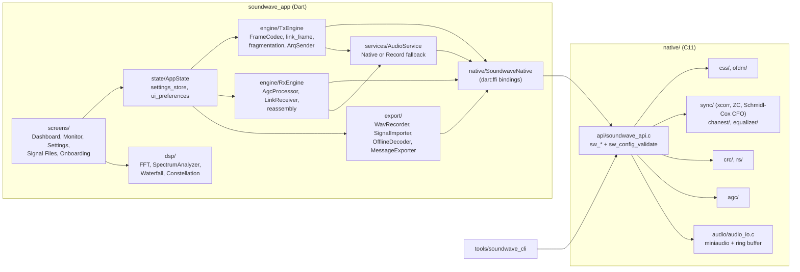
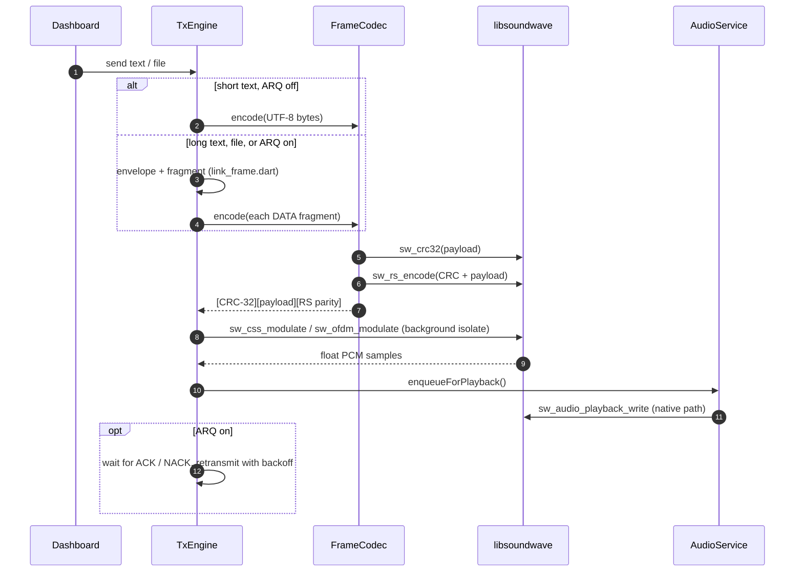
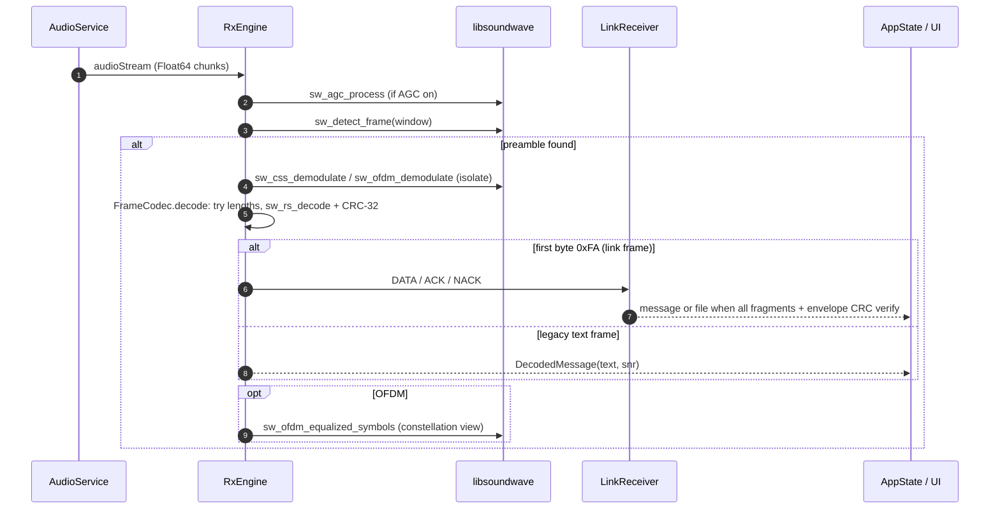

# Architecture overview

Soundwave is split into a native DSP core that knows nothing about the UI, and a Flutter app that owns framing, the link layer, audio routing and the user interface.

## Components

| Layer | Location | Responsibility |
|---|---|---|
| C API | `native/include/soundwave_api.h`, `native/src/api/` | Stable C ABI. Every function that takes `sw_config_t` validates it first (the FFI trust boundary) |
| DSP modules | `native/src/{css,ofdm,sync,chanest,equalizer,crc,rs,agc}` | Modulation, synchronization, channel estimation, FEC, AGC |
| Audio I/O | `native/src/audio/audio_io.c` | miniaudio capture and playback through single-producer/single-consumer 16-bit ring buffers (one second of audio, no locks). Android builds only AAudio and OpenSL ES |
| Bindings | `soundwave_app/lib/native/` | Library loading per platform, `SwConfig` struct, typed wrappers |
| Engines | `soundwave_app/lib/engine/` | Frame format, TX/RX pipelines, link layer, ARQ, metrics |
| Services | `soundwave_app/lib/services/` | Audio service selection, microphone permission, received-file storage |
| Export | `soundwave_app/lib/export/` | WAV recording, import and offline decode, message export, storage layout |
| UI | `soundwave_app/lib/{screens,widgets,onboarding,theme}` | Screens, visualizations, accessibility, theming |

## Transmit path

## Receive path

## Frame formats

There are **two different byte-level frame formats**, and they do not interoperate:

| Producer | Layout | Length field |
|---|---|---|
| App (`engine/frame_codec.dart`) | `[CRC-32 LE over payload][payload 1..219 B][RS parity 32 B]` | None. The receiver tries candidate lengths until RS + CRC verify |
| `soundwave-cli` (`tools/soundwave_cli/main.c`) | `[CRC-32 LE over payload][length u16 LE][payload 1..217 B][RS parity 32 B]` | Yes |

So a WAV made by `soundwave-cli modulate` cannot be decoded by the app's *Import Signal*, and an app recording cannot be decoded by `soundwave-cli demodulate`. Both use the same modulation and sync, so only the framing differs. The [field test plan](../testing/FIELD_TEST_PLAN.md) takes this into account.

The link layer (DATA/ACK/NACK frames, message envelope, reassembly and ARQ timing) runs inside the app frame's payload. It is specified in the [developer guide](../DEVELOPER_GUIDE.md#link-layer-fragmentation-file-transfer--arq-89-100).

## Threading

- Modulation and demodulation run on background isolates (`compute`) so the UI thread stays responsive. Imported files are decoded by `OfflineDecoder.decodeInBackground`.
- Native audio callbacks run on miniaudio's device thread and exchange samples with Dart through ring buffers (`sw_audio_capture_read` / `sw_audio_playback_write`).
- If the native audio service cannot be initialized, the app falls back to `RecordAudioService` (the `record` and `audioplayers` plugins, 44.1 kHz 16-bit mono).

## Persistence

| Data | Where | Lifetime |
|---|---|---|
| Modem and UI settings | `shared_preferences` (`soundwave.modem.*` and the UI-preference prefix) | Until changed or the app is uninstalled |
| Decoded-message log | Memory (max 100 entries) | App session. Written to disk only when you export |
| Recordings / exports / samples | `<app documents>/soundwave/{recordings,exports,samples}/` | Until you clear them in the app or uninstall |
| Received files | `<app documents>/Soundwave/received/` | Until deleted |

`engine/message_history.dart` (a JSON message history) exists but is not used by the app at present.
