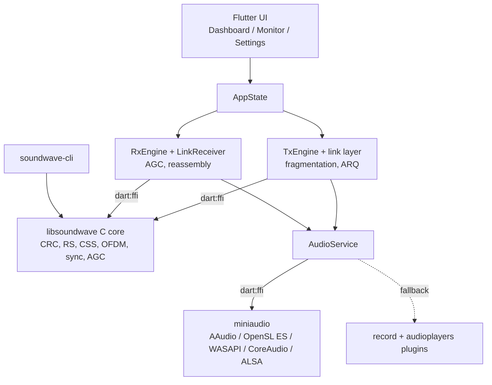

# Soundwave

Soundwave is an experimental acoustic modem. It sends short messages and small files between nearby devices over high-frequency sound, using an ordinary speaker and microphone. No network, Bluetooth or pairing is involved.

The project has two parts:

- **`native/`**: a portable C11 DSP core (`libsoundwave`). It provides CRC-32, Reed-Solomon RS(255,223), chirp (CSS) and OFDM modems, frame sync, CFO estimation, channel estimation and equalization, AGC, and miniaudio-based audio I/O behind a C ABI (`soundwave_api.h`). The same directory holds the `soundwave-cli` developer tool.
- **`soundwave_app/`**: a Flutter app for Android, Windows, macOS and Linux. It calls the core through `dart:ffi` and adds a link layer (fragmentation, file transfer, optional stop-and-wait ARQ), live spectrum, waterfall and constellation views, WAV recording, import and export, and onboarding.

!!! warning "Status: pre-release, no field measurements yet"
    All acoustic performance figures on this site are **design targets**, **values derived from the code**, or **simulations** (AWGN in CI). Each figure is labeled as one of these. No over-the-air measurement has been made with real devices yet; see the [field test plan](testing/FIELD_TEST_PLAN.md).

## Where to start

| I want to... | Go to |
|---|---|
| Build the library, CLI or app | [Build from source](getting-started/build.md) |
| Send my first message with the app | [Using the app](getting-started/user-guide.md) |
| Generate and decode WAV files from the command line | [CLI guide](CLI_GUIDE.md) |
| Understand how the pieces fit together | [Architecture overview](architecture/overview.md) |
| See band, rate and airtime numbers for a configuration | [Signal chain & parameters](architecture/signal-chain.md) |
| Call the C library | [C API](API_REFERENCE.md) |
| Work on the Flutter app | [Dart API](api/dart-api.md) |
| Play with chirps and constellations in the browser | [Signal Lab](lab/index.md) |
| Measure real-world performance | [Field test plan](testing/FIELD_TEST_PLAN.md), [Hardware profiling plan](testing/HARDWARE_PROFILING_PLAN.md) |

## Architecture at a glance

## License

Apache License 2.0. See [`LICENSE`](https://github.com/PxA-Labs/ultrasonic-phy-layer/blob/main/LICENSE).
